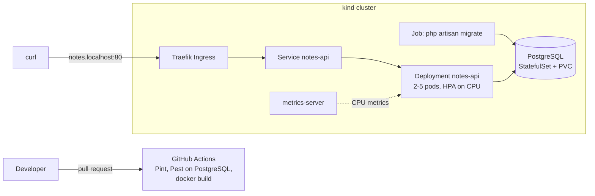
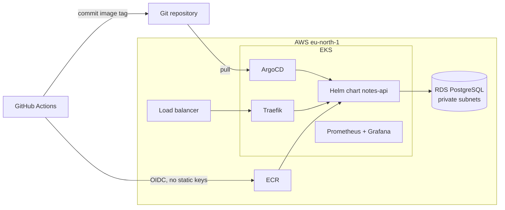

# laravel-k8s-aws

A Laravel API that goes from a laptop to AWS EKS. The project uses Docker,
Kubernetes, Helm, Terraform, ArgoCD and GitHub Actions.

I am building this project to get practical DevOps experience. Each step has a written
plan, failure drills and interview notes. The application is small on purpose. The
focus is on the platform around it.

## Status

| Day | Scope | Status |
|-----|-------|--------|
| 1 | AWS account security, Budgets, Laravel `notes` API with Pest tests | Done |
| 2 | Multi-stage Dockerfile, `docker-compose.yml`, `/health` and `/ready`, CI | Done |
| 3 | Local `kind` cluster: Deployment, Service, ConfigMap, Secret, PostgreSQL StatefulSet | Done |
| 4 | Traefik Ingress, migration Job, requests/limits, HPA, rolling update, drills | Done |
| 5 | Helm chart, Terraform `bootstrap/` (S3 state backend) | In progress |
| 6 | Terraform `base/` (VPC, ECR, IAM OIDC), image push to ECR from CI | Planned |
| 7 | ArgoCD (GitOps), migrations as a sync hook | Planned |
| 8 | kube-prometheus-stack, alert, dashboard. Terraform `eks/` plan | Planned |
| 9 | EKS + RDS with Terraform, deploy with `values-eks.yaml` | Planned |
| 10 | Monitoring on EKS, failure drills, `terraform destroy` | Planned |

## Architecture

Current state (days 1-4): the API runs in a local `kind` cluster.



Target state (day 9): CI pushes the image to ECR. ArgoCD deploys it to EKS. The
database is RDS.



## Engineering decisions

Each decision has a reason. Details are in the code comments and in `docs/plans/`.

- **Migrations run in a separate Job, not at container start.** With 3 replicas, 3
  parallel migrations can break the schema.
- **Two probes with different checks.** `/health` (liveness) does not check the
  database. `/ready` (readiness) does. A database outage removes pods from the Service,
  but Kubernetes does not restart them.
- **Graceful shutdown.** The base image's init ignores `SIGQUIT`. Kubernetes then
  waited 30 seconds and sent `SIGKILL`. `STOPSIGNAL SIGTERM` stops the container in ~3
  seconds. A `preStop` sleep keeps the pod alive until Traefik removes it from the
  endpoints. Without it, a rolling update gave 502 errors.
- **The Deployment has no `replicas` field.** The HPA controls the pod count. With
  the field, each `kubectl apply` reset the count to 2.
- **Non-root container.** The image runs as `www-data`. The pod sets `runAsNonRoot`
  with the numeric uid 33, because kubelet cannot check a user name.
- **CI tests run on PostgreSQL**, the same engine as in the cluster and in RDS. SQLite
  hides engine-specific errors.
- **Numeric route ids only.** On PostgreSQL, a non-numeric id gives an SQL error and a
  500 response instead of a 404.
- **Least privilege in CI.** The `GITHUB_TOKEN` can only read the code. AWS access
  will use OIDC and an IAM role, with no access keys in GitHub.
- **Traefik, not ingress-nginx.** ingress-nginx is retired (end of maintenance in 2026).

## Run locally

Requirements: Docker, `kind`, `kubectl`, `helm`.

### Docker Compose

1. Copy `.env.example` to `.env`.
2. Set `DB_PASSWORD` in `.env`.
3. Set `APP_KEY` in `.env`. This command makes a key without PHP:
   `echo "base64:$(openssl rand -base64 32)"`.
4. Start the stack:

```bash
docker compose up --build
curl http://127.0.0.1:8080/api/notes
```

Compose starts PostgreSQL first. Then it runs the migrations. The API starts only
after the migrations complete.

### kind cluster

```bash
kind create cluster --config k8s/kind-config.yaml

helm repo add traefik https://traefik.github.io/charts
helm repo add metrics-server https://kubernetes-sigs.github.io/metrics-server/
helm install traefik traefik/traefik --version 42.1.1 \
  -n traefik --create-namespace -f k8s/traefik-values.yaml --wait
helm install metrics-server metrics-server/metrics-server --version 3.14.0 \
  -n kube-system -f k8s/metrics-server-values.yaml --wait

docker build -t notes-api:local app
kind load docker-image notes-api:local --name notes

kubectl apply -f k8s/manifests/00-namespace.yaml
kubectl -n notes create secret generic notes-secrets \
  --from-literal=APP_KEY="$(grep '^APP_KEY=' .env | cut -d= -f2-)" \
  --from-literal=DB_PASSWORD="$(grep '^DB_PASSWORD=' .env | cut -d= -f2-)"
kubectl apply -f k8s/manifests/

curl http://notes.localhost/api/notes
```

Day 5 replaces `k8s/manifests/` with the Helm chart `helm/notes-api/`.

## API

| Method | Path | Description |
|--------|------|-------------|
| GET | `/api/notes` | List notes |
| POST | `/api/notes` | Create a note |
| GET | `/api/notes/{id}` | Show a note |
| PUT/PATCH | `/api/notes/{id}` | Update a note |
| DELETE | `/api/notes/{id}` | Delete a note |
| GET | `/health` | Liveness probe |
| GET | `/ready` | Readiness probe, checks the database |

## Repository layout

```
app/                  Laravel API, Dockerfile, Pest tests
docker-compose.yml    Local stack: PostgreSQL, migrations, API
k8s/                  kind config, Traefik and metrics-server values, raw manifests
.github/workflows/    CI
docs/plans/           Day-by-day implementation plans
docs/specs/           Design spec and glossary
docs/interview-notes.md   Answers to interview questions, in my own words
```

## Known simplifications

- Secrets on EKS will be a Kubernetes Secret. Production practice: External Secrets
  Operator with AWS Secrets Manager.
- One region, one NAT Gateway, no Multi-AZ RDS.
- nginx and php-fpm run in one container.
- EKS runs only for the demo days. Then `terraform destroy` removes it to control the
  cost.

## Documentation

- [Design spec](docs/specs/2026-10-14-laravel-k8s-aws-design.md)
- [Interview notes](docs/interview-notes.md)
- [Day-by-day plans](docs/plans/)
